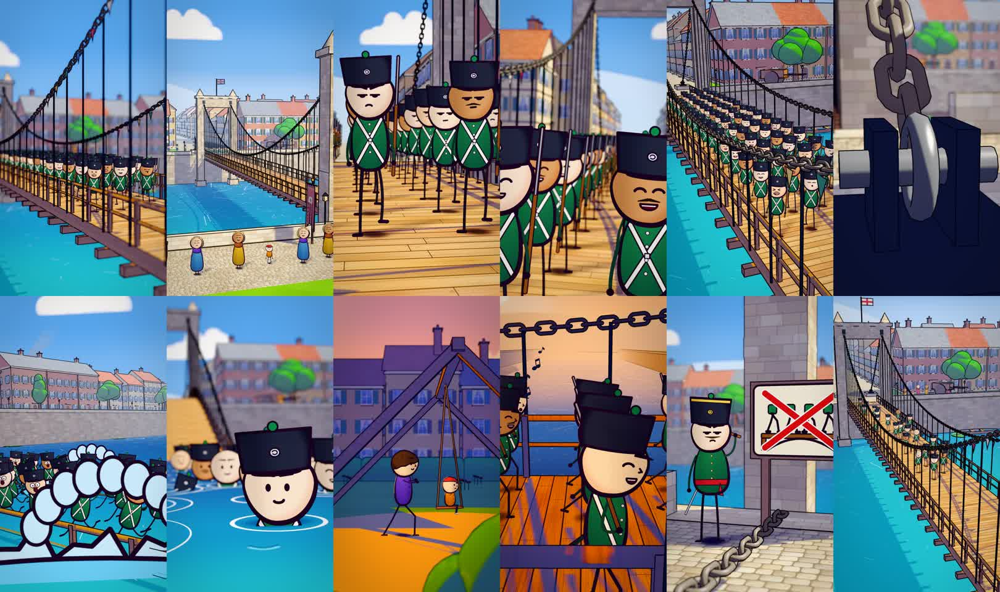

# cartoon-3d-video: фирменный мультяшный стиль для вертикальных роликов

Скилл для Claude: делает ролики 9:16 в одном стиле на любую тему. Плоские 2D-персонажи с обводкой живут в нарисованном 3D-мире с чёрными контурами, мягким размытием фона и плавной камерой. Всё строится на three.js + Remotion, без AI-видео.



## Как пользоваться
Скажи Claude: *«Используй скилл cartoon-3d-video. Вот сценарий и описание сцен: …»* (или *«придумай 5 тем»*).
Claude соберёт проект, переведёт сцены в код движка, покажет стоп-кадры, отрендерит mp4 и добавит звук.

## Что внутри
- `SKILL.md`: инструкция для Claude (порядок работы, перевод описания сцены в код, правила стиля, известные проблемы).
- `templates/engine/`: движок стиля (мир, свет day/golden/night, персонажи, эффекты, камера, контуры, размытие, цвет).
- `templates/videos/timemachine/`: пример ролика на новую тему, с него начинается каждый новый ролик.
- `templates/videos/lineup/`: справочный лист персонажей и эмоций.
- `templates/videos/bridge/`: полный 67-секундный ролик-эталон.
- `templates/project/`, `templates/scripts/`: проект с проверенными версиями, установка, стоп-кадры, рендер, QA.
- `templates/audio/`: синтез звуков, музыка, микс.
- `references/`: эталонные кадры, персонажи, лица, Style Bible и отчёты с измерениями стиля.

## Быстрый старт вручную
```bash
bash templates/scripts/setup.sh ~/cartoon-project my_video
cd ~/cartoon-project
node scripts/stills.mjs TimeMachine out/test_ 40,140,225 0.5
bash scripts/render.sh TimeMachine out/timemachine.mp4
```
Нужны Node.js 20+, Python 3, ffmpeg. Видеокарта не обязательна: без неё рендер идёт программно (медленнее).

Лицензия кода: MIT. Предметы рисуются кодом; модели Kenney (CC0) можно положить в `public/kenney/` по желанию.
